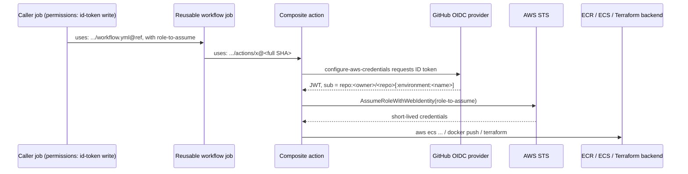
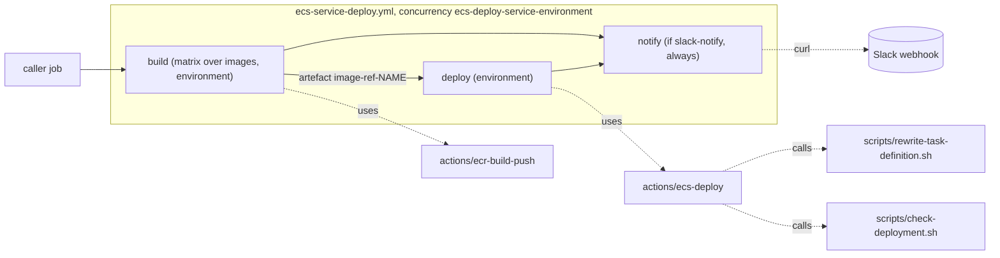
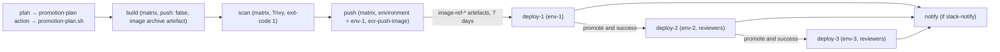
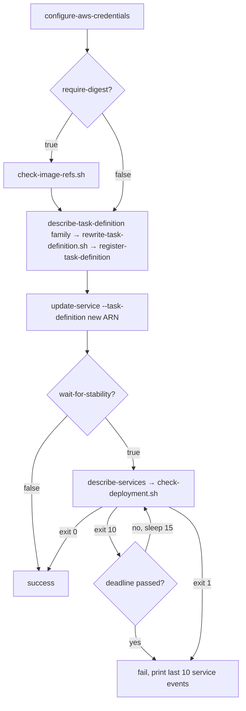
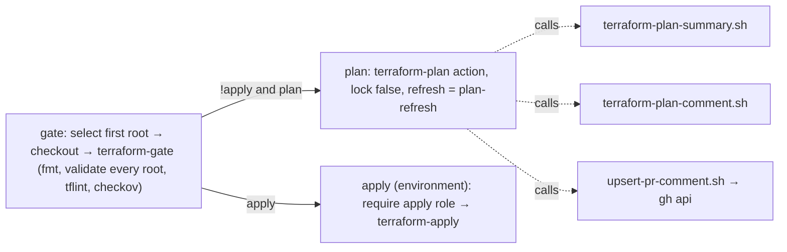
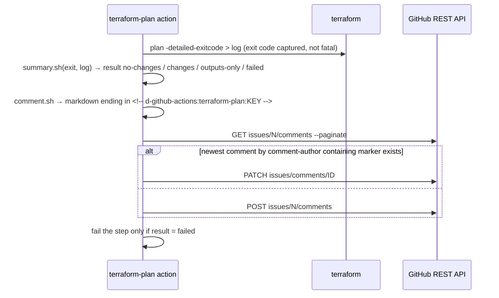

# Architecture

> Generated 2026-10-31 (INIT) from `v0.3.4` (`b384724`). Code wins over this file.

## Style

A library of building blocks in three layers: reusable workflow → composite action → bash script. The workflows own job ordering, concurrency, permissions and GitHub environments; the actions own tool setup and AWS login; the scripts own the decisions that can be tested offline (is this a digest, did the rollout complete, what does the plan summary say, which comment to edit). See `structure.md` for the map.

Every AWS call happens after `aws-actions/configure-aws-credentials` exchanges the job's GitHub OIDC token for short-lived role credentials. No step reads an AWS key.

## OIDC to AWS

The role's trust policy, not this repository, decides which `sub` claims may assume it. The README recommends scoping deploy and apply roles to `repo:<owner>/<repo>:environment:<name>` so only a job running in that GitHub environment can assume them (`README.md:90`, `README.md:121`).

## ecs-service-deploy.yml

Each build job pushes by tag (the commit SHA unless `image-tag` is set) and writes `name=registry/repo@sha256:...` to an artefact. The deploy job concatenates those into `container-images` (`ecs-service-deploy.yml:110-118`).

## ecs-promote.yml

The build job has no AWS access: `ecr-build-push` with `push: "false"` skips the credential and login steps and writes a `type=docker` archive (`actions/ecr-build-push/action.yml:62-97`). The digest is fixed at push. All deploys run `ecs-deploy` with `require-digest: "true"`, so `scripts/check-image-refs.sh` runs before any task definition is registered. Each deploy job skips unless `count` from the plan job reaches its position (`ecs-promote.yml:182,219,256`).

## ecs-deploy action

`check-deployment.sh` exit codes are a contract: 0 done, 10 keep polling, anything else failed (`scripts/check-deployment.sh:27-34`, `actions/ecs-deploy/action.yml:106-121`).

## terraform.yml

The gate validates every root in `roots`; plan and apply use only the first (`terraform.yml:71-76`). Plan runs with the plan role and `pull-requests: write`; apply runs with the apply role in the named GitHub environment.

### Plan comment flow

The comment step runs only on `pull_request` events (`actions/terraform-plan/action.yml:110`).

## Concurrency

| Workflow / job | Group | Cancel in progress |
| --- | --- | --- |
| `ecs-service-deploy.yml` (workflow) | `ecs-deploy-<service>-<environment>` | false |
| `ecs-promote.yml` (workflow) | `ecs-promote-<repository>-<ref>` | false |
| `terraform.yml` plan job | `terraform-plan-<working-directory>/<first root>-<ref>` | true |
| `terraform.yml` apply job | `terraform-apply-<working-directory>/<first root>-<ref>` | false |
